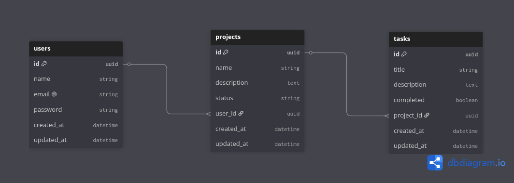

# 🚀 ProjectTaskFlow API

API REST para la gestión de proyectos y tareas desarrollada con **Node.js**, **Express 5**, **Sequelize** y **PostgreSQL**. Diseñada con arquitectura en capas (Layered Architecture) para garantizar modularidad, mantenibilidad y escalabilidad como proyecto de estudio.

---

## 📌 Tabla de Contenidos

- [Características](#-características)
- [Arquitectura del Proyecto](#-arquitectura-del-proyecto)
- [Modelo de Datos](#-modelo-de-datos)
- [Tecnologías Utilizadas](#-tecnologías-utilizadas)
- [Requisitos Previos](#-requisitos-previos)
- [Instalación y Configuración](#-instalación-y-configuración)
- [Variables de Entorno](#-variables-de-entorno)
- [Ejecución](#-ejecución)
- [Documentación Interactiva (Swagger)](#-documentación-interactiva-swagger)
- [Endpoints Principales](#-endpoints-principales)
- [Scripts Disponibles](#-scripts-disponibles)
- [Licencia](#-licencia)

---

## ✨ Características

- 🔐 **Autenticación y Autorización**: Registro y login de usuarios con contraseñas encriptadas mediante `bcrypt` y protección de rutas con tokens **JWT**.
- 📁 **Gestión de Proyectos**: Operaciones CRUD completas para proyectos asociados al usuario autenticado, incluyendo eliminación lógica (_soft delete_).
- ✅ **Gestión de Tareas**: Tareas asociadas a proyectos con soporte para paginación (`page`, `limit`), actualización de estados (completada/pendiente) y borrado.
- 🛡️ **Seguridad**: Cabeceras HTTP seguras con `helmet` y soporte de `cors`.
- 🔎 **Validación de Datos**: Validación de esquemas y parámetros en peticiones mediante `express-validator`.
- 📜 **Logging Estructurado**: Registro de eventos y peticiones HTTP con `pino` y `pino-pretty`.
- 📖 **Documentación Swagger**: Especificación OpenAPI 3.0 visualizable desde el navegador.

---

## 🏗 Arquitectura del Proyecto

El código está estructurado siguiendo una arquitectura desacoplada en capas:

```
src/
├── config/         # Configuraciones de entorno, base de datos, logger, JWT y Swagger
├── controllers/    # Controladores: manejan petición y respuesta HTTP
├── database/       # Inicialización y conexión de Sequelize ORM
├── entities/       # Modelos y asociaciones de la base de datos (Sequelize)
├── middlewares/    # Middlewares: autenticación, validaciones, logging y manejo de errores
├── repositories/   # Capa de acceso a datos y consultas directas a la base de datos
├── routes/         # Definición de rutas y mapeo con controladores
├── services/       # Capa de lógica de negocio
├── utils/          # Clases y funciones auxiliares (AppError, successResponse)
├── validators/     # Esquemas de validación con express-validator
├── app.js          # Configuración de la aplicación Express
└── server.js       # Punto de entrada y arranque del servidor HTTP
```

---

## 🗄 Modelo de Datos

Relación entre entidades:

- **User** 1 : N **Project** (Un usuario tiene muchos proyectos).
- **Project** 1 : N **Task** (Un proyecto tiene muchas tareas).



### Entidades

- **User**: `id` (UUID), `name`, `email`, `password`, `createdAt`, `updatedAt`
- **Project**: `id` (UUID), `name`, `description`, `status`, `userId` (FK), `createdAt`, `updatedAt`
- **Task**: `id` (UUID), `title`, `description`, `completed`, `projectId` (FK), `createdAt`, `updatedAt`

---

## 🛠 Tecnologías Utilizadas

- **Entorno de ejecución**: [Node.js](https://nodejs.org/) (ES Modules)
- **Framework web**: [Express 5](https://expressjs.com/)
- **Base de datos**: [PostgreSQL](https://www.postgresql.org/)
- **ORM**: [Sequelize v6](https://sequelize.org/)
- **Seguridad**: [bcrypt](https://www.npmjs.com/package/bcrypt), [jsonwebtoken](https://www.npmjs.com/package/jsonwebtoken), [helmet](https://helmetjs.github.io/), [cors](https://www.npmjs.com/package/cors)
- **Validaciones**: [express-validator](https://express-validator.github.io/)
- **Logging**: [pino](https://getpino.io/) & [pino-pretty](https://www.npmjs.com/package/pino-pretty)
- **Documentación API**: [swagger-ui-express](https://www.npmjs.com/package/swagger-ui-express) & [swagger-jsdoc](https://www.npmjs.com/package/swagger-jsdoc)
- **Linter y Formateador**: [ESLint](https://eslint.org/) & [Prettier](https://prettier.io/)

---

## 📋 Requisitos Previos

- [Node.js](https://nodejs.org/) v18.0.0 o superior instalado.
- [PostgreSQL](https://www.postgresql.org/) v13 o superior en ejecución con una base de datos creada.

---

## ⚙️ Instalación y Configuración

1. **Clonar el repositorio**:

   ```bash
   git clone <URL_DEL_REPOSITORIO>
   cd project-task-flow-api
   ```

2. **Instalar dependencias**:

   ```bash
   npm install
   ```

3. **Configurar variables de entorno**:
   Copia el archivo de ejemplo y completa los valores con tus credenciales locales:
   ```bash
   cp .env.example .env
   ```

---

## 🔑 Variables de Entorno

Configura en tu archivo `.env`:

| Variable         | Descripción                                         | Valor por Defecto |
| :--------------- | :-------------------------------------------------- | :---------------- |
| `PORT`           | Puerto donde corre el servidor                      | `3000`            |
| `NODE_ENV`       | Entorno de ejecución (`development` / `production`) | `development`     |
| `DB_HOST`        | Host del servidor PostgreSQL                        | `localhost`       |
| `DB_PORT`        | Puerto de PostgreSQL                                | `5432`            |
| `DB_NAME`        | Nombre de la base de datos                          | -                 |
| `DB_USER`        | Usuario de PostgreSQL                               | -                 |
| `DB_PASSWORD`    | Contraseña del usuario                              | -                 |
| `JWT_SECRET`     | Clave secreta para firmar los tokens                | -                 |
| `JWT_EXPIRES_IN` | Tiempo de expiración del token JWT (ej. `1d`, `7d`) | `1d`              |
| `LOG_LEVEL`      | Nivel de logging (`info`, `debug`, `error`)         | `info`            |

---

## 🚀 Ejecución

### Modo Desarrollo (con recarga automática)

Utiliza el watcher nativo de Node.js:

```bash
npm run dev
```

### Modo Producción

```bash
npm start
```

El servidor estará accesible en `http://localhost:3000` (o el puerto configurado en `PORT`).

---

## 📚 Documentación Interactiva (Swagger)

Una vez iniciado el servidor, puedes explorar y probar todos los endpoints desde la interfaz Swagger UI:

🔗 **`http://localhost:3000/api-docs`**

---

## 🔌 Endpoints Principales

### Sistema

- `GET /` - Mensaje de bienvenida
- `GET /health` - Estado de salud de la API

### Autenticación (`/auth`)

| Método | Endpoint         | Descripción                        | Acceso  |
| :----- | :--------------- | :--------------------------------- | :------ |
| `POST` | `/auth/register` | Registrar nuevo usuario            | Público |
| `POST` | `/auth/login`    | Iniciar sesión y obtener token JWT | Público |

### Proyectos (`/projects`)

> _Requiere cabecera: `Authorization: Bearer <token>`_

| Método   | Endpoint        | Descripción                                        | Acceso  |
| :------- | :-------------- | :------------------------------------------------- | :------ |
| `GET`    | `/projects`     | Listar todos los proyectos del usuario autenticado | Privado |
| `POST`   | `/projects`     | Crear un nuevo proyecto                            | Privado |
| `GET`    | `/projects/:id` | Obtener detalle de proyecto con sus tareas         | Privado |
| `PUT`    | `/projects/:id` | Actualizar nombre y descripción de un proyecto     | Privado |
| `DELETE` | `/projects/:id` | Eliminación lógica (_soft delete_) de un proyecto  | Privado |

### Tareas (`/tasks`)

> _Requiere cabecera: `Authorization: Bearer <token>`_

| Método   | Endpoint                            | Descripción                                               | Acceso  |
| :------- | :---------------------------------- | :-------------------------------------------------------- | :------ |
| `GET`    | `/tasks/:projectId?page=1&limit=10` | Listar tareas de un proyecto paginadas                    | Privado |
| `POST`   | `/tasks/:projectId`                 | Crear nueva tarea en el proyecto                          | Privado |
| `PATCH`  | `/tasks/:projectId`                 | Actualizar título/descripción de una tarea (`id` en body) | Privado |
| `DELETE` | `/tasks/:projectId`                 | Eliminar físicamente una tarea (`id` en body)             | Privado |
| `PATCH`  | `/tasks/:projectId/complete`        | Marcar tarea como completada (`id` en body)               | Privado |
| `PATCH`  | `/tasks/:projectId/pending`         | Marcar tarea como pendiente (`id` en body)                | Privado |

---

## 🧰 Scripts Disponibles

- `npm run dev`: Inicia el servidor con recarga automática (`node --watch`).
- `npm start`: Inicia el servidor de forma estándar.
- `npm run lint`: Ejecuta el análisis estático de código con ESLint.
- `npm run lint:fix`: Corrige automáticamente problemas detectados por ESLint.
- `npm run format`: Formatea todos los archivos del proyecto con Prettier.

---

## 📄 Licencia

Este proyecto está bajo la Licencia **MIT**. Desarrollado por **Javier Onishi**.
